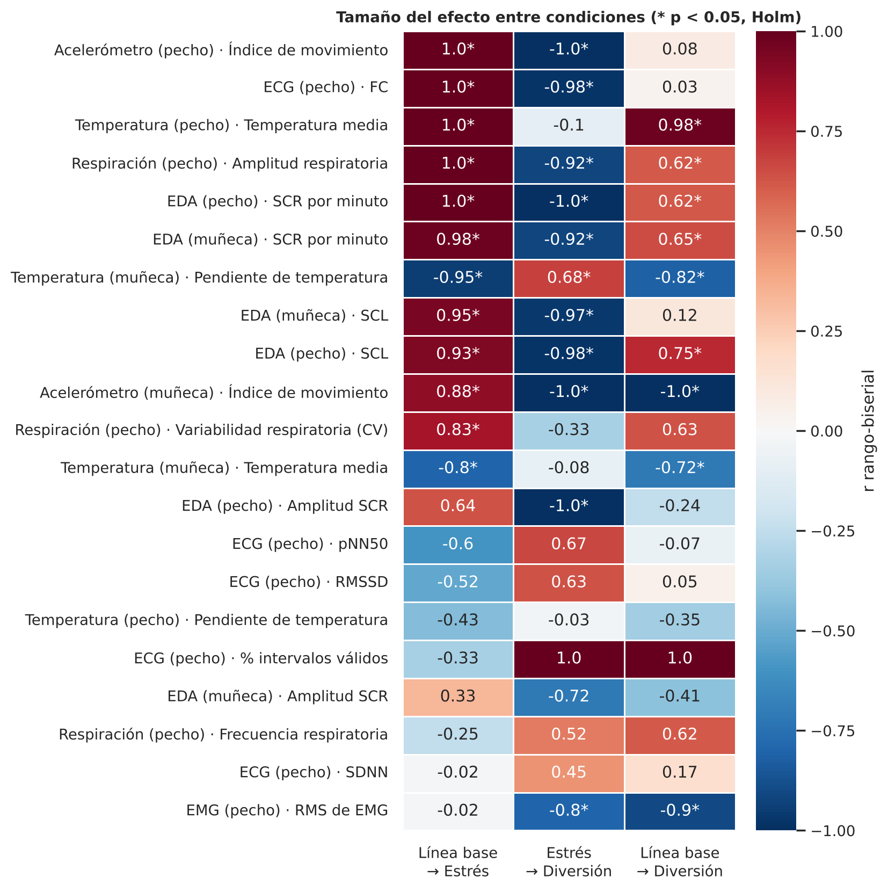

# Multimodal Stress Pattern Identification from Physiological Signals (WESAD)

> Reproducible preprocessing, quality control and feature-extraction pipeline for detecting stress from wearable physiological signals, built on the public **WESAD** dataset.


## Overview

Stress has measurable physiological signatures: heart rate rises, skin conductance responses become more frequent, and breathing changes. This project builds a rigorous, end-to-end pipeline that turns the raw chest- and wrist-worn sensor recordings from [WESAD](https://ubicomp.eti.uni-siegen.de/home/datasets/icmi18/) (Schmidt et al., 2018) into clean, labelled, model-ready data. Its goals are to:

1. **Characterise** how stress shows up in each physiological signal (objective 1).
2. **Prepare** windowed features for binary (*stress vs. no-stress*) and 3-class (*baseline / stress / amusement*) classification (objective 2).

The repository is part of a thesis project. Chapter 1 (exploratory analysis and preprocessing) is complete; the feature-extraction work for chapter 2 is under way.

## Highlights

- **15 subjects and 10 signals:** chest ECG, EDA, respiration, temperature, EMG and accelerometer; wrist BVP, EDA, temperature and accelerometer.
- **Literature-backed configuration:** every threshold (valid ranges, saturation, flat-line detection, filters, window size) lives in [`wesad_pre/config.py`](pipeline_capitulo1/wesad_pre/config.py), each with its reference. Example: a 50 Hz notch filter, because WESAD was recorded in Germany.
- **Per-sample quality control:** each sample is marked as *exclude* or *flag* (out of range, saturation, flat signal, stuck values, jumps). The resulting masks are saved per subject.
- **Physiological event detection:** R-peaks (ECG), breaths (respiration) and skin conductance responses (EDA), plus signal-quality indices.
- **Statistical validation:** Friedman tests, Kendall's W, pairwise Wilcoxon tests with rank-biserial effect sizes and Holm correction, comparing baseline, stress and amusement.
- **Windowing:** 60 s windows with a 0.25 s step, a ≥ 80 % valid-sample rule per modality, and both label schemes exported. That gives **≈162 k windows**, with 100 % retention on the core chest signals.
- **Large-scale feature extraction:** a 455-feature catalogue covering time, frequency, wavelet, entropy, fractal/DFA, Lempel–Ziv and RQA features, plus multimodal features. It uses incremental, resumable per-subject checkpoints so it runs on limited memory.

## Key findings (Chapter 1)

Medians across 15 subjects. All baseline-vs-stress differences below are significant after Holm correction (p < 0.001).

| Signal | Marker | Baseline | Stress | Kendall's W |
|---|---|---:|---:|---:|
| Chest ECG | Heart rate (bpm) | 70.8 | 89.7 | 0.66 |
| Chest EDA | SCRs per minute | 0.30 | 2.98 | 0.78 |
| Chest EDA | Skin conductance level (µS) | 2.81 | 3.93 | 0.59 |
| Chest respiration | Breathing amplitude (a.u.) | 6.67 | 10.89 | 0.70 |
| Chest temperature | Mean temperature (°C) | 33.71 | 34.35 | 0.65 |

Heart rate, electrodermal activity and breathing amplitude separate stress from both baseline and amusement consistently. Short-term HRV measures (RMSSD, SDNN) do not differ significantly at this resolution. Based on these results, the base model uses **chest ECG, EDA and respiration**, with chest temperature as an optional complement.

<p align="center">
  
</p>

## Repository structure

```
├── pipeline_capitulo1/            # Chapter 1: EDA + preprocessing (run notebooks in order)
│   ├── 01_inventario_y_etiquetas.ipynb   # data inventory, protocol, labels, questionnaires
│   ├── 02_control_de_calidad.ipynb       # per-sample quality control on the 10 signals
│   ├── 03_limpieza_y_eventos.ipynb       # filtering, R-peaks, breaths, SCRs, signal quality
│   ├── 04_marcadores_y_variabilidad.ipynb# physiological markers + statistical tests
│   ├── 05_ventanas_y_exportacion.ipynb   # 60 s windows + label export
│   ├── wesad_pre/                        # reusable Python package (config, loading, QC, cleaning, stats…)
│   └── salidas/                          # generated tables, figures and QC masks
├── extraccion_features/           # Chapter 2: feature extraction (455 features, NeuroKit2 add-ons)
└── BASE_DE_CONOCIMIENTO.html      # project knowledge base / literature notes
```

## Getting started

1. Download the WESAD dataset from the [official page](https://ubicomp.eti.uni-siegen.de/home/datasets/icmi18/). It is about 17 GB and cannot be redistributed. Place the `WESAD/` folder (with `S2/`, `S3/`, …) next to `pipeline_capitulo1/`.
2. Install the dependencies:
   ```bash
   pip install numpy pandas scipy matplotlib seaborn neurokit2 cvxopt
   ```
3. Run the notebooks in `pipeline_capitulo1/` in order (01 → 05). They are committed already executed, so you can read the results without running anything.

> **Note:** WESAD `.pkl` files are already in physical units. Converting them again excludes 100 % of the data, a bug this pipeline explicitly avoids.

## Tech stack

Python · NumPy · pandas · SciPy · NeuroKit2 · Matplotlib · Seaborn · Jupyter

## Reference

Schmidt, P., Reiss, A., Duerichen, R., Marberger, C., & Van Laerhoven, K. (2018). *Introducing WESAD, a Multimodal Dataset for Wearable Stress and Affect Detection.* ICMI 2018.

## Author

**Laura Nicole Bermúdez Santa**, Universidad Nacional de Colombia · [GitHub](https://github.com/bermudez05)
